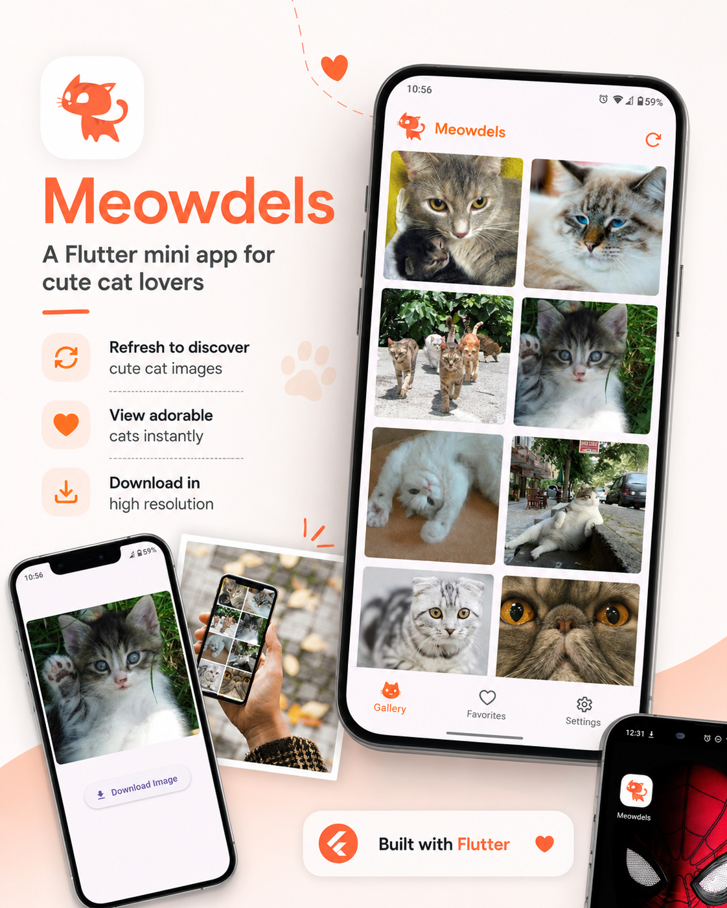

# Meowdels

A simple and playful Flutter mini app for discovering cute cat images.

Meowdels lets users refresh the gallery to discover new cat photos, view them individually, and download high-resolution images directly to their device.


## Features

- 🐱 Discover cute cat images
- 🔄 Refresh to load new images
- 🖼️ View individual images in full size
- 📥 Download high-resolution images
- 📱 Simple and lightweight mobile experience
- ⚡ Built with Flutter

## About the Project

Meowdels was created as a small Flutter project focused on delivering a simple and enjoyable experience for cat lovers.

Each refresh brings a new collection of cat images. Users can explore the gallery, open an image they like, and save the high-resolution version directly to their device.

The project also serves as a practical example of working with:

- Remote image data
- Network requests
- Dynamic UI updates
- Image previews
- File downloads
- Flutter mobile development

## App Preview



## Built With

- [Flutter](https://flutter.dev/)
- [Dart](https://dart.dev/)

## Getting Started

Follow the steps below to run Meowdels locally.

### Prerequisites

Make sure you have the following installed:

- Flutter SDK
- Dart SDK
- Android Studio or Visual Studio Code
- Android Emulator or a physical device

Check your Flutter installation:

```bash
flutter doctor